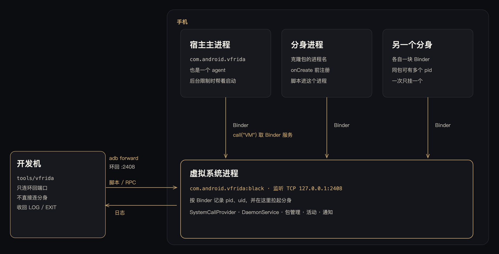

[中文](README.zh-CN.md)

# vFrida

Source: https://github.com/vFrida/vFrida

`tools/vfrida` is the command-line client. It sends a script into the vFrida host or into one cloned app and prints the logs back. The flags follow the Frida command line: spawn with `-f`, attach with `-n` or `-p`, load a file with `-l`.

vFrida itself is an Android app-cloning sandbox. The host package is `com.android.vfrida`. A cloned app runs inside that package, not as a normal install. Install the APK, open the clone from the vFrida UI, then use the vFrida CLI. Scripts run on **arm64** only, in QuickJS, with Frida Gum's Interceptor and Stalker.



The dev machine never connects to a clone directly. It only talks to `com.android.vfrida:black` on `127.0.0.1:2408`. The host process and each clone are agents: they register over Binder, receive the script, and send logs back. USB mode runs `adb forward tcp:0 tcp:2408` for you.

## Spawn, attach, list

Put `tools/` on PATH once (or add it to your shell profile), then from the repo root with one device plugged in:

```bash
export PATH="$PWD/tools:$PATH"

# Stop the clone on user 0, start it, inject, then let it continue
vfrida -U -f com.example.app -l tools/test_js_api.js

# Attach to a clone that is already running
vfrida -U -n com.example.app -l tools/test_native_hook.js

# Attach to a pid, including the host process com.android.vfrida
vfrida -U -p 12345 -l tools/test_js_api.js

# One line of script, no file
vfrida -U -n com.example.app -e 'console.log("hi")'

# Registered processes, JSON
vfrida -U --list

# Same list, as a table
vfrida-ps -U
```

`-f` is spawn. The client sends the script, then `UNLOCK`. The clone waits on the startup path until that frame arrives, so the script is in place before `Application.onCreate`. `-f` always uses user 0.

`-n` and `-p` attach. The process must already have registered. A name is the process name vFrida recorded, usually the cloned package name. The host UI process is `com.android.vfrida`.

More than one phone:

```bash
vfrida -D <serial> -n com.example.app -l tools/test_js_api.js
```

If the port is already forwarded, skip adb:

```bash
vfrida -H 127.0.0.1:2408 -n com.example.app -l tools/test_js_api.js
```

`-H`, `-U`, and `-D` pick the connection. Pass only one of them. Pass only one of `-f`, `-n`, and `-p`.

The client stays up and prints `console.log` until the process exits, the server drops, or you hit Ctrl-C.

## Scripts

A script is plain JavaScript. These samples live in `tools/`:


| File                  | What it does                                |
| --------------------- | ------------------------------------------- |
| `test_js_api.js`      | `Memory`, pointers, `Module`, `Interceptor` |
| `test_native_hook.js` | `Interceptor.attach("libz.so!deflate", …)`  |
| `test_java_hook.js`   | `Java.hook` on `Resources.getDisplayMetrics` |
| `test_stalker.js`     | `Stalker.follow` from inside a hook         |
| `test_rpc.js`         | `rpc.exports` called from the command line  |


`console.log` comes back as a log line. On armeabi-v7a there is no runtime; an RPC there replies with `js runtime is not in vfrida`.

Call an export after the script loads. `--args` is a JSON array and lines up with the matching `--call`:

```bash
vfrida -U -n com.example.app -l tools/test_rpc.js --call ping --args '["hi"]'
```

That prints `pong hi`, then keeps waiting for logs.


Project overview and module map: [ABOUT.md](ABOUT.md).

## Community

WeChat group for questions and feedback (the QR code is refreshed when it expires):


